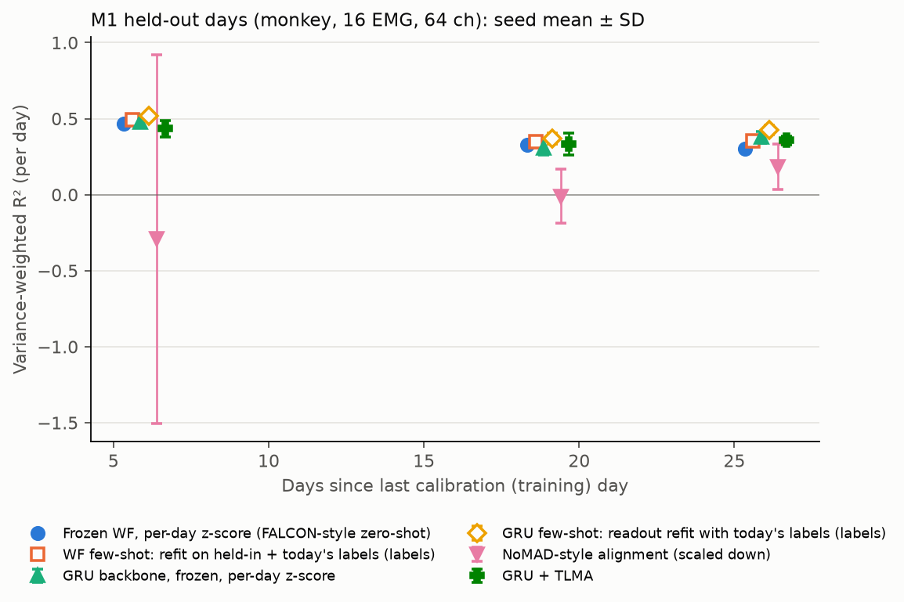

# falcon-stability

**Can label-free adaptation replace labelled recalibration of an intracortical BCI decoder across days?**
On the [FALCON benchmark](https://snel-repo.github.io/falcon/) (Karpowicz, Ye et al., NeurIPS 2024), with the methods I tested: **no.** I compared frozen decoders, labelled few-shot recalibration, two published label-free stabilisers, and two label-free alignment methods I designed. On human data (H1) and monkey data (M1), nothing label-free reliably beat simply re-normalising each day's inputs, while a minute of labels did.

Every number below is regenerated from CSVs in [`results/`](results/) by [`scripts/summarize.py`](scripts/summarize.py), and CI fails if the committed tables drift from the committed rows. Each row records the git SHA it was produced with. This follows up my hackathon project [neurorecursion](https://github.com/sandeepvijayarao09/neurorecursion), whose evaluation was ad hoc.

## Findings

1. **Per-day input normalisation is the label-free step that matters.** It needs only the new day's unlabelled statistics. On M1 test days, a frozen Wiener filter z-scored with held-in statistics scores R² **−4.44**; z-scored with each day's own statistics it scores **+0.37** (3/3 days). Most of the collapse comes from a few channels that were nearly silent on held-in days and fire 80–280× more later, reaching z ≈ 77. Clipping z at ±5 recovers −4.44 → −0.30, still far below per-day normalisation. FALCON's zero-shot reference already normalises per day, so that is the baseline any method has to beat.
2. **Labels help; label-free alignment did not.** On the H1 minival protocol (5 days, bootstrap over days), refitting the Wiener filter with about 1.6 minutes of today's labels adds **+0.093 [+0.054, +0.134]** R² over the per-day-normalised frozen decoder, winning 5/5 days. Every label-free alignment method scores *below* that frozen decoder (Δ −0.03 to −0.12).
3. **A nonlinear frozen backbone is task-dependent.** A small GRU with per-day normalisation beats the frozen Wiener filter on 2/3 M1 test days (mean Δ +0.023) but loses on 5/5 H1 minival days (Δ −0.059 [−0.098, −0.023]). With 3 M1 days, the M1 result is indicative only.
4. **My alignment methods are a negative result** (details below). TLMA, its behaviour-reweighted variant, and their GRU-space versions never beat their own unaligned parents by a margin distinguishable from zero, and on M1 minival GRU + TLMA *hurt* (Δ −0.154, 1/3 days).

## Results

**Units and statistics.** FALCON scores variance-weighted R² per *day* (all files of a day concatenated), and so do I. Stochastic methods (GRU-based, FA) are averaged over 5 seeds first; deterministic methods are run once and have no seed SD. **H1**: mean over days with a 95% percentile bootstrap over days. **M1**: only 3 days per protocol, so I show each day and a sign count instead of a CI. "Days > ref" counts days a method beats the FALCON-style per-day-normalised Wiener filter. Full tables, including paired comparisons against each method's direct parent, are in [`results/summary_test.md`](results/summary_test.md), [`results/summary_minival.md`](results/summary_minival.md) and [`results/summary_dev.md`](results/summary_dev.md).

**Uses today's:** *nothing* means no new-day data at all; *unlabelled (norm. stats)* means only per-channel means and SDs of today's unlabelled block; *unlabelled* means it also fits an alignment on that block; *labels* means it fits on today's labelled block.

### M1 (monkey, 64 ch → 16 EMG): held-out days, local split

| Method | Uses today's | +6 d | +19 d | +26 d | mean | days > ref | seed SD |
|---|---|---|---|---|---|---|---|
| Frozen WF, held-in normalisation | nothing | −5.220 | −4.479 | −3.619 | −4.440 | 0/3 | – |
| … same, z clipped to ±5 | nothing | −0.277 | −0.319 | −0.307 | −0.301 | 0/3 | – |
| **Frozen WF, per-day z-score (FALCON-style zero-shot, ref)** | unlabelled (norm. stats) | +0.466 | +0.326 | +0.303 | **+0.365** | – | – |
| WF few-shot: held-in + today's labels | labels | +0.492 | +0.347 | +0.356 | +0.398 | 3/3 | – |
| FA + Procrustes (Degenhart 2020 style) | unlabelled | +0.400 | +0.264 | +0.287 | +0.317 | 0/3 | 0.019 |
| PCA latents, frozen | unlabelled (norm. stats) | +0.455 | +0.327 | +0.289 | +0.357 | 1/3 | – |
| Covariance-only alignment (lag 0) | unlabelled | +0.441 | +0.319 | +0.301 | +0.354 | 0/3 | – |
| TLMA | unlabelled | +0.441 | +0.316 | +0.300 | +0.352 | 0/3 | – |
| BR-TLMA | unlabelled | +0.247 | +0.295 | +0.163 | +0.235 | 0/3 | – |
| **GRU backbone, frozen, per-day z-score** | unlabelled (norm. stats) | +0.479 | +0.306 | +0.377 | **+0.388** | 2/3 | 0.023 |
| GRU few-shot: readout refit with today's labels | labels | +0.517 | +0.370 | +0.426 | +0.438 | 3/3 | 0.014 |
| GRU + drift augmentation (after Sussillo 2016) | unlabelled (norm. stats) | +0.466 | +0.312 | +0.367 | +0.381 | 1/3 | 0.022 |
| GRU + TLMA | unlabelled | +0.435 | +0.332 | +0.358 | +0.375 | 2/3 | 0.045 |
| NoMAD-style (scaled down, **unstable**) | unlabelled | −0.292 | −0.010 | +0.183 | −0.040 | 0/3 | 0.444 |



*Seed mean ± SD (bars only for stochastic methods). Hollow markers use labels. No connecting lines: 3 days with 7–13 days between them is not a trend.*

### H1 (human, 176 ch → 7-DoF reach/grasp): minival protocol

For each held-in day d after the first: train on earlier held-in days, adapt on the first ~1.6 min of day d's calibration file (the budget FALCON gives few-shot methods on held-out days), and score on day d's minival (later trials of the same session). Drift here is only 1–7 days.

| Method | Uses today's | R² [95% CI over 5 days] | Δ vs ref [95% CI] | days > ref | seed SD |
|---|---|---|---|---|---|
| Frozen WF, held-in normalisation | nothing | −0.071 [−0.160, +0.006] | −0.137 [−0.216, −0.077] | 0/5 | – |
| **Frozen WF, per-day z-score (ref)** | unlabelled (norm. stats) | **+0.065 [+0.023, +0.108]** | – | – | – |
| WF few-shot: held-in + today's labels | labels | +0.159 [+0.099, +0.226] | **+0.093 [+0.054, +0.134]** | 5/5 | – |
| FA + Procrustes | unlabelled | −0.055 [−0.090, −0.019] | −0.121 [−0.181, −0.068] | 0/5 | 0.018 |
| PCA latents, frozen | unlabelled (norm. stats) | +0.030 [−0.004, +0.057] | −0.036 [−0.073, −0.005] | 1/5 | – |
| TLMA | unlabelled | +0.029 [−0.005, +0.056] | −0.036 [−0.076, −0.003] | 1/5 | – |
| BR-TLMA | unlabelled | +0.034 [−0.000, +0.064] | −0.031 [−0.068, +0.000] | 1/5 | – |
| GRU backbone, frozen | unlabelled (norm. stats) | +0.006 [−0.046, +0.049] | −0.059 [−0.098, −0.023] | 0/5 | 0.010 |
| GRU few-shot | labels | +0.158 [+0.120, +0.197] | +0.093 [+0.044, +0.139] | 5/5 | 0.015 |
| NoMAD-style | unlabelled | +0.011 [−0.040, +0.051] | −0.054 [−0.088, −0.020] | 1/5 | 0.007 |
| GRU + TLMA | unlabelled | +0.011 [−0.036, +0.058] | −0.054 [−0.112, −0.011] | 1/5 | 0.012 |

The H1 held-out-day split and the M1 minival protocol are in the supplementary tables ([`results/summary_test.md`](results/summary_test.md), [`results/summary_minival.md`](results/summary_minival.md)) and in [`figures/h1_by_day_supplement.png`](figures/h1_by_day_supplement.png).

## Checks against the paper

| Check | This repo | FALCON (paper Table 1 / repo) | Match? |
|---|---|---|---|
| H1 zero-shot WF, held-in **minival** R² | **0.194** with FALCON's per-day grouping (0.192 per file), [`results/check_reference.txt`](results/check_reference.txt) | 0.195 (repo README), 0.20 (Table 1) | Yes |
| H1 reference WF "CV fit score" | 0.191 | 0.26 | No: the reference globs files unsorted, so its 80/20 split depends on filesystem order |
| M1 zero-shot WF, held-out | 0.365 (local split) | 0.34 ± 0.06 (private eval data) | Consistent |
| H1 zero-shot WF, held-out | −0.027 (local split) | 0.16 ± 0.03 | **No**: the local split is uninformative on H1 (below) |
| M1 NoMAD, held-out | −0.04, unstable over seeds | 0.49 ± 0.03 | **No**: mine is a simplified re-implementation, not a reproduction |
| CycleGAN + WF | not implemented | M1 0.43, H1 0.12 | – |

**Differences from FALCON's reference pipeline.** My per-day z-score uses the mean/SD of *smoothed* counts from the adaptation block; the official sklearn demo uses the mean/SD of *raw* counts of the whole calibration file. Hence the row name "FALCON-style", not "FALCON reference".

## Protocols

FALCON's held-out *evaluation* data is private (EvalAI only). Its calibration split is the first 10% of each held-out session: 1.5–1.8 min on H1, 1.1–2.2 min on M1. Locally I use three protocols ([`protocol.py`](src/falcon_stability/protocol.py)):

- **test (local split)**: train on all held-in days; split each held-out calibration file 50/50 in time into an adaptation block and a scored block. On M1 this behaves sensibly. **On H1 it is uninformative**: about 24 s scored per file, and the two halves cover different movements. The total-variation distance between per-DoF variance shares is 0.39 on H1 vs 0.11 on M1 ([`results/behaviour_shift.json`](results/behaviour_shift.json)), so even a decoder fit on that day's own labels scores about 0. H1 test results are reported only in the supplement.
- **minival**: described above. Uses longer, behaviourally richer scored windows, but only 1–7 days of drift.
- **dev**: held-in days only, used for **all** hyperparameter selection, via [`scripts/dev_sweep.py`](scripts/dev_sweep.py): argmax of mean dev R² over a fixed grid, with results in `results/*_dev_sweep.csv`.

**Leakage and forking paths, stated plainly.**
- The first round of this study (commit `df5a61b`) froze its config before seeing test data. This second round (after an external review) changed scoring and fixed a bug, then re-ran the same selection rule mechanically. **The test split had already been seen**, so round-2 test numbers are not blind. The re-selection changed one setting: M1 NoMAD's β went from 0.1 to 0, which made NoMAD unstable.
- **The minival protocol scores the same days that dev selection used** (H1 days 4–6, M1 days 3–4), on different bins. Its numbers are therefore optimistic for tuned methods; untuned baselines (per-day z-score, few-shot) are unaffected.

## Methods

All pipelines smooth binned spikes with FALCON's causal 240 ms exponential filter, z-score them, and decode with ridge regression. α is chosen by 5-fold CV on reference data, as in `falcon-challenge`'s `sklearn_decoder.py`.

- **Baselines**: frozen WF with held-in or per-day normalisation, and a variant clipped to ±5 (the clip was fixed a priori, not tuned); few-shot WF refit on held-in + today's labels, or on today's labels alone.
- **FA + Procrustes** (after [Degenhart et al. 2020](https://doi.org/10.1038/s41551-020-0542-9)): per-day factor analysis; channels whose loadings disagree with the reference are dropped iteratively; the latents are then Procrustes-aligned on the stable channels.
- **NoMAD-style** (after [Karpowicz et al. 2022](https://doi.org/10.1101/2022.04.06.487388)): a frozen causal GRU dynamics model (Poisson next-bin prediction). On a new day, an affine input-alignment layer and the readout are trained with Poisson NLL + β·KL between Gaussian fits of GRU states. Simplifications: a GRU instead of LFADS, and 300 adaptation steps. **It is unstable across seeds** (M1 test seed SD 0.44, one seed-day at −2.42), so I draw no conclusions from it.
- **GRU frozen / few-shot / drift augmentation**: the same GRU as a zero-shot backbone; with its readout refit on today's labels; or trained with random per-channel gains, offsets and dropout (after [Sussillo et al. 2016](https://doi.org/10.1038/ncomms13749)).
- **TLMA**, time-lagged moment alignment (designed here, tested as a hypothesis): learn a k×k map A so the new day's lagged latent covariances match the reference's for τ ∈ {0, 1, 2, 4, 8, 16} bins, with a ridge pull toward the identity. Covariances are pooled *within* files, never across file boundaries. The idea is AMUSE/SOBI-style identifiability: lag-0 covariance fixes A only up to a rotation, and lagged moments can break that symmetry.
- **BR-TLMA**: TLMA with reference bins importance-weighted so the frozen decoder's output distribution on the reference matches today's (Gaussian density ratio). This was meant to handle short blocks that cover only some movements.

**Related label-free alignment work** not re-implemented here: distribution alignment DAD ([Dyer et al. 2017](https://doi.org/10.1038/s41551-017-0169-7)), adversarial ADAN (Farshchian et al., ICLR 2019), CycleGAN ([Ma et al. 2023](https://doi.org/10.7554/eLife.84296)), and diffusion-based ERDiff (Wang et al., NeurIPS 2023).

## Negative results and what limits them

- **TLMA does not help, and the A≈I explanation is ruled out.** Logged per adaptation ([`results/diagnostics.md`](results/diagnostics.md)): across tasks and protocols, TLMA moves A by a mean ‖A−I‖_F of 0.44–0.56 (0.08–0.16 per dimension), 1.9–2.8× more than covariance-only alignment. Yet paired against its parent (PCA latents, no alignment) it is −0.005 on M1 test (1/3 days) and −0.001 on H1 minival (3/5 days). Lag terms vs covariance-only: −0.001 (M1 test) and −0.003 [−0.006, −0.000] (H1 minival). The alignment changes the latents, but not in a way the decoder benefits from.
- **Why lagged moments may not identify much here.** The synthetic tests ([`tests/test_core.py`](tests/test_core.py)) show TLMA recovers only part of a pure rotation even with 20k bins and distinct autocorrelations: relative error 0.19–0.49, where 1.0 means no better than the identity. With equal autocorrelations it cannot identify the rotation at all; the solution is arbitrary without the ridge. I also symmetrise each lagged covariance, which discards the antisymmetric (rotational-dynamics) part; motor cortex's rotational dynamics are exactly what that throws away. With about 1.6 minutes of data, estimation noise in the lagged moments adds to this.
- **BR-TLMA helps its parent on H1, not on M1.** It beats TLMA on 6/7 H1 test days and 5/5 H1 minival days, but by small margins (+0.012 and +0.005), and it still trails the per-day-normalised WF. On M1 test it is far worse than TLMA (−0.118, 0/3). On M1 dev it tied PCA-latents-frozen (0.482 vs 0.480), while the frozen GRU (0.567) and GRU + augmentation (0.586) were the best dev methods. So there was no dev-to-test "reversal" for BR-TLMA; it was never the best label-free method on dev.
- **GRU + BR-TLMA mostly isn't BR-TLMA on M1.** In GRU space, the density-ratio weights collapse on M1: the guard falls back to uniform weights (plain TLMA) in 8/15 test and 10/15 minival adaptations. I added the guard after a NaN crash on the round-1 test split.
- **Alignment hurts when the backbone is already normalised.** FA + Procrustes, NoMAD-style, TLMA and covariance alignment are all at or below the per-day-normalised baseline on M1 test and H1 minival.
- **Small n.** M1 has 3 days per protocol, so no M1 claim is established. H1 minival has 5 days, and its intervals are percentile bootstraps over 5 units, which are optimistic.
- **Scope.** H2 was downloaded but not run (it needs a CTC handwriting decoder). M2 (~16 GB) and M1-B were not downloaded. CycleGAN was not implemented.

## Why this matters for a BCI product

Every minute of calibration is a minute the user isn't using the device. These results argue for spending engineering effort on two things:
1. **Cheap, robust label-free normalisation**: per-session normalisation, plus protection against channels that come alive. On M1, a ±5 clip alone removes most of a −4.4 collapse.
2. **Making a short labelled calibration count**: on H1, about 1.6 minutes of labels was worth +0.09 R², more than any label-free method gained.

The more elaborate unsupervised alignment I tested did not pay for itself with about a minute of data, and its label-free objectives could not tell when it was hurting. A deployed system needs a check that can refuse an adaptation, and the evaluation must compare against a normalised baseline: against raw frozen decoding, almost anything looks like a large win.

## Reproduce

```bash
uv venv --python 3.11 .venv
uv pip install --python .venv/bin/python -r requirements.lock && uv pip install --python .venv/bin/python --no-deps -e .
.venv/bin/python scripts/get_data.py h1 m1            # ~0.4 GB from DANDI, verified against data_manifest.json
.venv/bin/python scripts/check_reference.py           # official H1 WF minival check
.venv/bin/python scripts/dev_sweep.py --task h1 --select && .venv/bin/python scripts/dev_sweep.py --task m1 --select
for s in test minival dev; do for t in h1 m1; do .venv/bin/python scripts/run_experiments.py --task $t --split $s; done; done
.venv/bin/python scripts/diagnose_behaviour.py && .venv/bin/python scripts/summarize.py
.venv/bin/python -m pytest -q
```

On a laptop CPU, the full set of runs takes about 1.5 hours. M1 is pinned to DANDI 000941 version 0.241029.1405. H1 (000954) has no published DANDI version, so `data_manifest.json`'s SHA-256 checksums are the pin. `run_experiments.py` refuses to run on uncommitted code and rewrites its output file in full.

## Repo map

| Path | What |
|---|---|
| `src/falcon_stability/data.py` | Loads NWB via the official `falcon_challenge` loader, caches to `.npz` |
| `src/falcon_stability/methods.py` | WF baselines, FA + Procrustes, TLMA, BR-TLMA, covariance ablation |
| `src/falcon_stability/nomad.py` | GRU backbone, NoMAD-style alignment, GRU few-shot / augmentation / TLMA variants |
| `src/falcon_stability/protocol.py` | test / minival / dev protocols, per-day scoring |
| `configs/frozen_config.json` | Hyperparameters selected by `dev_sweep.py --select` |
| `results/` | Per-day rows (`*_rows.csv`), dev sweeps, summaries, diagnostics, run log |
| `docs/SUBMITTING.md` | How to submit to the FALCON EvalAI leaderboard |

## Next steps

1. **EvalAI submission** of the per-day-normalised WF and the frozen GRU: the only way to get held-out H1 numbers comparable with Table 1 ([`docs/SUBMITTING.md`](docs/SUBMITTING.md)).
2. **More days**: M1-B and M2 (~16 GB) would put M1-style claims on more than 3 days.
3. **A label-free acceptance test**: accept an adaptation only if a held-out slice of the unlabelled block improves under the frozen dynamics model's likelihood, and first measure whether that score tracks true R² at all.
4. **A faithful NoMAD and CycleGAN**, to compare against the published numbers instead of simplified versions.
