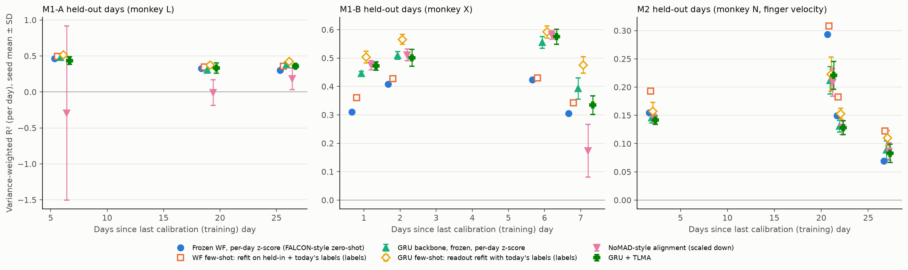

# falcon-stability

**Can label-free adaptation replace labelled recalibration of an intracortical BCI decoder across days?**
On the [FALCON benchmark](https://snel-repo.github.io/falcon/) (Karpowicz, Ye et al., NeurIPS 2024), with the methods I tested: **no.**

I compared frozen decoders, labelled few-shot recalibration, two published label-free stabilisers, and two label-free alignment methods I designed. The data covers four datasets: a human (H1) and three monkeys (M1-A, M1-B, M2). Across all of them, about a minute of labels reliably helped. Explicit label-free alignment never beat simply re-normalising each day's inputs. The one label-free gain I found came from a better frozen backbone, and only on one task family.

Every number below is regenerated from CSVs in [`results/`](results/) by [`scripts/summarize.py`](scripts/summarize.py), and CI fails if the committed tables drift from the committed rows. Each row records the git SHA that produced it. This repo follows up my hackathon project [neurorecursion](https://github.com/sandeepvijayarao09/neurorecursion), whose evaluation was ad hoc.

## Findings

1. **Per-day input normalisation is the label-free step that matters.** It needs only the new day's unlabelled per-channel statistics. Pooled over 7 held-out M1 days from two monkeys, a frozen Wiener filter (WF) z-scored with held-in statistics scores R² **−1.779**; z-scored with each day's own statistics it scores **+0.363** (7/7 days). On M1-A most of the collapse comes from a few channels that were nearly silent on held-in days and fire 80–280× more later, reaching z ≈ 77. Clipping z at ±5 brings the pooled score to +0.002, still far below per-day normalisation. FALCON's zero-shot reference already normalises per day, so that is the baseline any method has to beat.
2. **Labels help on every dataset.** Refitting the WF with today's labels beats the per-day-normalised frozen WF on 7/7 pooled M1 days (**+0.030 [+0.019, +0.042]**), on 4/4 M2 days (+0.035), and on 5/5 H1 minival days (**+0.093 [+0.054, +0.134]**). About 1.6 minutes of labels is the budget FALCON gives few-shot methods.
3. **A nonlinear frozen backbone helps on M1 only.** A small GRU with per-day normalisation, using no labels, beats the frozen WF on pooled M1 by **+0.075 [+0.034, +0.112]** (6/7 days; 4/4 on M1-B). It loses on M2 (−0.023, 1/4 days) and on H1 minival (−0.059 [−0.098, −0.023], 0/5).
4. **Explicit alignment never helped.** FA + Procrustes, NoMAD-style alignment, and my TLMA and BR-TLMA either fail to beat their own unaligned parent by a margin distinguishable from zero, or are worse. Pooled M1: TLMA vs its parent +0.003 [−0.017, +0.024]; GRU + TLMA vs GRU −0.008 [−0.032, +0.014]. Details are in *Negative results*.

## Results

**Units and statistics.** FALCON scores variance-weighted R² per *day*: all of a day's files are concatenated. I score the same way. Stochastic methods (GRU-based, FA) are averaged over 5 seeds first; deterministic methods are run once and have no seed SD.
- **Pooled M1 (7 days) and H1 minival (5 days):** mean over days with a 95% percentile bootstrap over days.
- **Single monkeys (3–4 days each):** per-day values and sign counts only, with no CI.
- **"Days > ref":** days on which a method beats the FALCON-style per-day-normalised Wiener filter.

Full per-dataset tables, including paired comparisons against each method's direct parent and the M1-A/M1-B/M2 minival supplements, are in [`results/summary_test.md`](results/summary_test.md), [`results/summary_minival.md`](results/summary_minival.md) and [`results/summary_dev.md`](results/summary_dev.md).

**Uses today's:**
- *nothing*: no new-day data at all;
- *unlabelled (norm. stats)*: only per-channel means and SDs of today's unlabelled block;
- *unlabelled*: also fits an alignment on that block;
- *labels*: fits on today's labelled block.

### M1 pooled: M1-A + M1-B (two monkeys, 64 ch → 16 EMG), 7 held-out days, local split

| Method | Uses today's | R² [95% CI over 7 days] | Δ vs ref [95% CI] | days > ref | seed SD |
|---|---|---|---|---|---|
| Frozen WF, held-in normalisation | nothing | −1.779 [−3.544, −0.278] | −2.142 [−3.909, −0.644] | 0/7 | – |
| … same, z clipped to ±5 | nothing | +0.002 [−0.210, +0.214] | −0.361 [−0.569, −0.159] | 0/7 | – |
| **Frozen WF, per-day z-score (FALCON-style zero-shot, ref)** | unlabelled (norm. stats) | **+0.363 [+0.322, +0.411]** | – | – | – |
| WF few-shot: held-in + today's labels | labels | +0.394 [+0.359, +0.435] | +0.030 [+0.019, +0.042] | 7/7 | – |
| FA + Procrustes (Degenhart 2020 style) | unlabelled | +0.139 [−0.001, +0.271] | −0.224 [−0.383, −0.087] | 0/7 | 0.024 |
| PCA latents, frozen | unlabelled (norm. stats) | +0.348 [+0.306, +0.398] | −0.015 [−0.034, +0.000] | 2/7 | – |
| Covariance-only alignment (lag 0) | unlabelled | +0.354 [+0.318, +0.395] | −0.009 [−0.028, +0.006] | 3/7 | – |
| TLMA | unlabelled | +0.351 [+0.319, +0.388] | −0.012 [−0.033, +0.008] | 2/7 | – |
| BR-TLMA | unlabelled | +0.267 [+0.219, +0.325] | −0.096 [−0.153, −0.043] | 1/7 | – |
| **GRU backbone, frozen, per-day z-score** | unlabelled (norm. stats) | **+0.438 [+0.379, +0.495]** | **+0.075 [+0.034, +0.112]** | 6/7 | 0.007 |
| GRU few-shot: readout refit with today's labels | labels | +0.493 [+0.440, +0.544] | +0.130 [+0.086, +0.168] | 7/7 | 0.006 |
| GRU + drift augmentation (after Sussillo 2016, **unstable**) | unlabelled (norm. stats) | +0.358 [+0.173, +0.490] | −0.005 [−0.172, +0.109] | 4/7 | 0.221 |
| GRU + TLMA | unlabelled | +0.430 [+0.368, +0.495] | +0.066 [+0.018, +0.116] | 6/7 | 0.022 |
| NoMAD-style (scaled down, **unstable**) | unlabelled | +0.232 [+0.009, +0.436] | −0.131 [−0.383, +0.072] | 3/7 | 0.196 |



*Seed mean ± SD (bars only for stochastic methods). Hollow markers use labels. No connecting lines: days are unevenly spaced and few.*

### M2 (monkey N, 96 ch → 2-D finger velocity), 4 held-out days, local split

| Method | Uses today's | +2 d | +21 d | +22 d | +27 d | mean | days > ref | seed SD |
|---|---|---|---|---|---|---|---|---|
| Frozen WF, held-in normalisation | nothing | +0.095 | +0.236 | −0.063 | −0.106 | +0.041 | 0/4 | – |
| **Frozen WF, per-day z-score (ref)** | unlabelled (norm. stats) | +0.155 | +0.293 | +0.150 | +0.069 | **+0.167** | – | – |
| WF few-shot: held-in + today's labels | labels | +0.193 | +0.308 | +0.183 | +0.122 | +0.202 | 4/4 | – |
| TLMA | unlabelled | +0.103 | +0.240 | +0.143 | +0.067 | +0.138 | 0/4 | – |
| GRU backbone, frozen | unlabelled (norm. stats) | +0.145 | +0.212 | +0.131 | +0.088 | +0.144 | 1/4 | 0.007 |
| GRU few-shot | labels | +0.157 | +0.223 | +0.153 | +0.110 | +0.161 | 3/4 | 0.007 |
| NoMAD-style | unlabelled | +0.144 | +0.209 | +0.128 | +0.086 | +0.142 | 1/4 | 0.005 |
| GRU + TLMA | unlabelled | +0.142 | +0.220 | +0.128 | +0.083 | +0.143 | 1/4 | 0.006 |

### H1 (human, 176 ch → 7-DoF reach/grasp): minival protocol

For each held-in day d after the first: train on earlier held-in days, adapt on the first ~1.6 min of day d's calibration file, and score on day d's minival (later trials of the same session). Drift here is only 1–7 days.

| Method | Uses today's | R² [95% CI over 5 days] | Δ vs ref [95% CI] | days > ref | seed SD |
|---|---|---|---|---|---|
| Frozen WF, held-in normalisation | nothing | −0.071 [−0.160, +0.006] | −0.137 [−0.216, −0.077] | 0/5 | – |
| **Frozen WF, per-day z-score (ref)** | unlabelled (norm. stats) | **+0.065 [+0.023, +0.108]** | – | – | – |
| WF few-shot: held-in + today's labels | labels | +0.159 [+0.099, +0.226] | **+0.093 [+0.054, +0.134]** | 5/5 | – |
| FA + Procrustes | unlabelled | −0.055 [−0.090, −0.019] | −0.121 [−0.181, −0.068] | 0/5 | 0.018 |
| PCA latents, frozen | unlabelled (norm. stats) | +0.030 [−0.004, +0.057] | −0.036 [−0.073, −0.005] | 1/5 | – |
| TLMA | unlabelled | +0.029 [−0.005, +0.056] | −0.036 [−0.076, −0.003] | 1/5 | – |
| BR-TLMA | unlabelled | +0.034 [−0.000, +0.064] | −0.031 [−0.068, +0.000] | 1/5 | – |
| GRU backbone, frozen | unlabelled (norm. stats) | +0.006 [−0.046, +0.049] | −0.059 [−0.098, −0.023] | 0/5 | 0.010 |
| GRU few-shot | labels | +0.158 [+0.120, +0.197] | +0.093 [+0.044, +0.139] | 5/5 | 0.015 |
| NoMAD-style | unlabelled | +0.011 [−0.040, +0.051] | −0.054 [−0.088, −0.020] | 1/5 | 0.007 |
| GRU + TLMA | unlabelled | +0.011 [−0.036, +0.058] | −0.054 [−0.112, −0.011] | 1/5 | 0.012 |

The H1 held-out-day split is in the supplementary tables and in [`figures/h1_by_day_supplement.png`](figures/h1_by_day_supplement.png).

## Checks against the paper

| Check | This repo | FALCON (paper Table 1 / repo) | Match? |
|---|---|---|---|
| H1 zero-shot WF, held-in **minival** R² | **0.194** with FALCON's per-day grouping ([`results/check_reference.txt`](results/check_reference.txt)) | 0.195 (repo README), 0.20 (Table 1) | Yes |
| Same, through FALCON's own evaluator with my online decoder and official normalisation | 0.195 | 0.195 | Yes |
| H1 reference WF "CV fit score" | 0.191 | 0.26 | No: the reference globs files unsorted, so its 80/20 split depends on filesystem order |
| M1-A zero-shot WF, held-out | 0.365 (local split) | 0.34 ± 0.06 (private eval data) | Consistent |
| M2 zero-shot WF, held-out | 0.167 (local split) | 0.06 ± 0.04 (private eval data) | Different eval data; not comparable |
| H1 zero-shot WF, held-out | −0.027 (local split) | 0.16 ± 0.03 | **No**: the local split is uninformative on H1 (below) |
| M1-A NoMAD, held-out | −0.040, unstable over seeds | 0.49 ± 0.03 | **No**: mine is a simplified re-implementation, not a reproduction |
| CycleGAN + WF | not implemented | M1 0.43, H1 0.12 | – |

**Normalisation statistics matter more than I expected.** My per-day z-score uses the mean and SD of *smoothed* counts from the adaptation block. The official sklearn demo uses the mean and SD of *raw* counts of each calibration file, hence the row name "FALCON-style", not "FALCON reference". Because the decoder is trained on smoothed-count z-scores, dividing by the larger raw-count SD shrinks every prediction toward the mean.

Measured with FALCON's own evaluator on held-in minival ([`results/evalai_local/`](results/evalai_local/)), raw statistics give:
- **H1:** WF 0.195 vs 0.171, GRU 0.149 vs 0.069;
- **M2:** WF 0.100 vs 0.012, GRU 0.094 vs 0.087;
- **M1-A:** they *hurt* (WF 0.375 vs 0.386, GRU 0.437 vs 0.458).

The research tables use the smoothed statistics throughout, so methods are compared consistently; this choice is a known confound for absolute numbers.

## Protocols

FALCON's held-out *evaluation* data is private (EvalAI only). Its calibration split is the first 10% of each held-out session: 1.5–1.8 min on H1, 1.1–2.2 min on M1, 0.8–1.7 min on M2. Locally I use three protocols ([`protocol.py`](src/falcon_stability/protocol.py)):

- **test (local split)**: train on all held-in days; split each held-out calibration file 50/50 in time into an adaptation block and a scored block. This behaves sensibly on M1 and M2. **On H1 it is uninformative**: about 24 s is scored per file, and the two halves cover different movements. The total-variation distance between per-DoF variance shares is 0.39 on H1 vs 0.11 on M1-A ([`results/behaviour_shift.json`](results/behaviour_shift.json)), so even a decoder fit on that day's own labels scores about 0.
- **minival**: described above. Informative on H1. On the monkeys, minival files are tiny (M1: about 260 scored bins per day; M2: 117–194 bins per file), so monkey minival results are supplementary only.
- **dev**: held-in days only, used for **all** hyperparameter selection, via [`scripts/dev_sweep.py`](scripts/dev_sweep.py): argmax of mean dev R² over a fixed grid, with results in `results/*_dev_sweep.csv` and the selected values in [`configs/frozen_config.json`](configs/frozen_config.json).

**Leakage and forking paths, stated plainly.**
- The first round of this study (commit `df5a61b`) froze its config before seeing test data. The second round, after an external review, changed scoring, fixed a bug, and re-ran the same selection rule mechanically, so **H1 and M1-A test days had already been seen** and their round-2 numbers are not blind. M1-B and M2 were added in round 3 and selected only on their own dev days before any test run.
- **The minival protocol scores the same days that dev selection used** (H1 days 4–6), on different bins. Its numbers are therefore optimistic for tuned methods; untuned baselines (per-day z-score, few-shot) are unaffected.
- **Pooled M1 combines rows from two code commits** (`1cb3c13` for M1-A, `bd86777` for M1-B). The changes between them added data loading for new tasks and refactored module imports; no numerical code changed.

## Methods

All pipelines smooth binned spikes with FALCON's causal 240 ms exponential filter, z-score them, and decode with ridge regression. α is chosen by 5-fold CV on reference data, as in `falcon-challenge`'s `sklearn_decoder.py`.

- **Baselines**: frozen WF with held-in or per-day normalisation, and a variant clipped to ±5 (the clip was fixed a priori, not tuned); few-shot WF refit on held-in + today's labels, or on today's labels alone.
- **FA + Procrustes** (after [Degenhart et al. 2020](https://doi.org/10.1038/s41551-020-0542-9)): per-day factor analysis; channels whose loadings disagree with the reference are dropped iteratively; the latents are then Procrustes-aligned on the stable channels.
- **NoMAD-style** (after [Karpowicz et al. 2022](https://doi.org/10.1101/2022.04.06.487388)): a frozen causal GRU dynamics model (Poisson next-bin prediction). On a new day, an affine input-alignment layer and the readout are trained with Poisson NLL + β·KL between Gaussian fits of GRU states. Simplifications: a GRU instead of LFADS, and 300 adaptation steps. **It is unstable across seeds** (M1-A test seed SD 0.44, one seed-day at −2.42), so I draw no conclusions from it.
- **GRU frozen / few-shot / drift augmentation**: the same GRU as a zero-shot backbone; with its readout refit on today's labels; or trained with random per-channel gains, offsets and dropout (after [Sussillo et al. 2016](https://doi.org/10.1038/ncomms13749)). Augmentation is also unstable: it collapsed to R² −0.167 on one M1-B day (seed SD 0.39).
- **TLMA**, time-lagged moment alignment (designed here, tested as a hypothesis): learn a k×k map A so the new day's lagged latent covariances match the reference's for τ ∈ {0, 1, 2, 4, 8, 16} bins, with a ridge pull toward the identity. Covariances are pooled *within* files, never across file boundaries. The idea is AMUSE/SOBI-style identifiability: lag-0 covariance fixes A only up to a rotation, and lagged moments can break that symmetry.
- **BR-TLMA**: TLMA with reference bins importance-weighted so the frozen decoder's output distribution on the reference matches today's (Gaussian density ratio). This was meant to handle short blocks that cover only some movements.

**Related label-free alignment work** not re-implemented here: distribution alignment DAD ([Dyer et al. 2017](https://doi.org/10.1038/s41551-017-0169-7)), adversarial ADAN (Farshchian et al., ICLR 2019), CycleGAN ([Ma et al. 2023](https://doi.org/10.7554/eLife.84296)), and diffusion-based ERDiff (Wang et al., NeurIPS 2023).

## Negative results and what limits them

- **TLMA does not help, and A≈I is not the reason.** Logged per adaptation ([`results/diagnostics.md`](results/diagnostics.md)), TLMA moves A substantially more than covariance-only alignment does. Yet it ties its unaligned parent: +0.003 [−0.017, +0.024] on pooled M1, +0.001 on M2 (1/4 days), and −0.001 [−0.006, +0.004] on H1 minival. The lag terms add nothing over covariance-only alignment: −0.003 [−0.018, +0.011] on pooled M1. The alignment changes the latents, but not in a way the decoder benefits from.
- **Why lagged moments may not identify much here.** The synthetic tests ([`tests/test_core.py`](tests/test_core.py)) show TLMA recovers only part of a pure rotation even with 20k bins and distinct autocorrelations: relative error 0.19–0.49, where 1.0 means no better than the identity. With equal autocorrelations it cannot identify the rotation at all. I also symmetrise each lagged covariance, which discards the antisymmetric (rotational-dynamics) part, and motor cortex's rotational dynamics are exactly what that throws away. With about a minute of data, estimation noise adds to this.
- **BR-TLMA hurts on the monkeys.** It is worse than TLMA on pooled M1 (−0.084 [−0.137, −0.031], 1/7 days). It beats TLMA slightly on H1 (+0.005 on minival, 5/5 days) but still trails the per-day-normalised WF. In GRU space its density-ratio weights collapse on M1-A, and the guard falls back to plain TLMA in most adaptations (`fallback` column in the rows CSVs). I added the guard after a NaN crash on the round-1 test split.
- **Alignment hurts when the backbone is already normalised.** FA + Procrustes is the clearest case: −0.224 on pooled M1 and −0.121 on H1 minival.
- **Small n.** Each monkey has 3–4 test days; pooled M1 has 7 days from two animals; H1 minival has 5 days. Percentile bootstraps over 5–7 units are optimistic.
- **Scope.** H2 (handwriting) was downloaded but not run, because it needs a CTC decoder. CycleGAN was not implemented.

## Why this matters for a BCI product

Every minute of calibration is a minute the user isn't using the device. These results argue for three things:
1. **Cheap, robust label-free normalisation.** Per-session normalisation, plus protection against channels that come alive (a ±5 clip removes most of a −4.4 collapse on M1-A). The normalisation details themselves move absolute performance by up to 0.09 R².
2. **A good pretrained backbone.** On M1 it gave the only label-free gain (+0.075).
3. **Making a short labelled calibration count.** Labels helped on every dataset.

The more elaborate unsupervised alignment I tested did not pay for itself with about a minute of data, and its label-free objectives could not tell when it was hurting. A deployed system needs a check that can refuse an adaptation, and the evaluation must compare against a normalised baseline: against raw frozen decoding, almost anything looks like a large win.

## Leaderboard submission

[`SUBMIT.md`](SUBMIT.md) describes ready-to-push EvalAI images for the frozen WF and the frozen GRU on H1, M1 and M2. They are built for `linux/amd64` and tested with FALCON's own evaluator, both natively and in Docker. Nothing has been submitted; a held-out leaderboard number is the main missing check for H1.

## Reproduce

```bash
uv venv --python 3.11 .venv
uv pip install --python .venv/bin/python -r requirements.lock && uv pip install --python .venv/bin/python --no-deps -e .
.venv/bin/python scripts/get_data.py h1 m1 m1b m2     # ~16.5 GB from DANDI (M2 is ~15.9 GB), verified against data_manifest.json
.venv/bin/python scripts/check_reference.py           # official H1 WF minival check
for t in h1 m1 m1b m2; do .venv/bin/python scripts/dev_sweep.py --task $t --select; done
for s in test minival dev; do for t in h1 m1 m1b m2; do .venv/bin/python scripts/run_experiments.py --task $t --split $s; done; done
.venv/bin/python scripts/diagnose_behaviour.py && .venv/bin/python scripts/summarize.py
.venv/bin/python -m pytest -q
```

On a laptop CPU, the full set of runs takes about 3 hours. M1-A is pinned to DANDI 000941 version 0.241029.1405. H1 (000954), M1-B (001209) and M2 (000953) have no published DANDI version, so `data_manifest.json`'s SHA-256 checksums are the pin. `run_experiments.py` refuses to run on uncommitted code and rewrites its output file in full.

## Repo map

| Path | What |
|---|---|
| `src/falcon_stability/data.py` | Loads NWB via the official `falcon_challenge` loader, caches to `.npz` |
| `src/falcon_stability/methods.py` | WF baselines, FA + Procrustes, TLMA, BR-TLMA, covariance ablation |
| `src/falcon_stability/nomad.py` | GRU backbone, NoMAD-style alignment, GRU few-shot / augmentation / TLMA variants |
| `src/falcon_stability/protocol.py` | test / minival / dev protocols, per-day scoring |
| `src/falcon_stability/submission.py` | Online `BCIDecoder` for EvalAI (WF and GRU), payload builder |
| `submission/` | Dockerfile, `decode.py` entry point, fitted payloads (`artifacts/*.pt`, 14–420 kB each) |
| `configs/frozen_config.json` | Hyperparameters selected by `dev_sweep.py --select` |
| `results/` | Per-day rows (`*_rows.csv`), dev sweeps, summaries, diagnostics, local-evaluator results, run log |

## Next steps

1. **Submit to EvalAI** (see [`SUBMIT.md`](SUBMIT.md)) to get held-out H1 numbers comparable with Table 1.
2. **A label-free acceptance test**: accept an adaptation only if a held-out slice of the unlabelled block improves under the frozen dynamics model's likelihood, and first measure whether that score tracks true R² at all.
3. **A faithful NoMAD and CycleGAN**, to compare against the published numbers instead of simplified versions.
