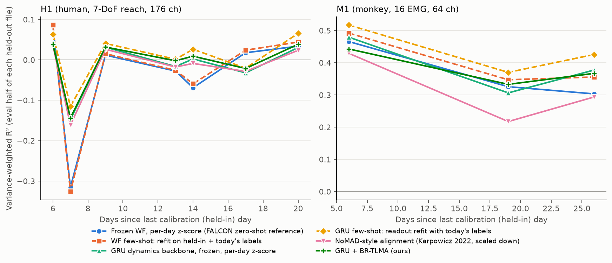

# falcon-stability

**How much of the cross-day decoder recalibration in an intracortical BCI can be removed without collecting any new labels?**

I tested that on the [FALCON benchmark](https://snel-repo.github.io/falcon/) (Karpowicz, Ye et al., NeurIPS 2024): real multi-day recordings from a human participant (H1) and a monkey (M1). I compared frozen decoders, labelled few-shot recalibration, two published label-free stabilisers, and two label-free methods of my own. Hyperparameters were chosen on held-in days only and frozen in [`configs/frozen_config.json`](configs/frozen_config.json) before any test-day run. Every number below comes from a CSV in [`results/`](results/).

This follows up my hackathon project [neurorecursion](https://github.com/sandeepvijayarao09/neurorecursion), whose evaluation was ad hoc. This repo puts the same question under a cleaner protocol.

## Short answer

1. **The biggest label-free win is the most boring one: normalise each day's inputs.** On M1, a frozen Wiener filter that z-scores inputs with each new day's unlabelled statistics scores R² **+0.37**. The same filter with held-in statistics scores **−4.44**. FALCON's "zero-shot" reference already does this, so it is the baseline to beat, not raw frozen decoding.
2. **A better frozen backbone beats explicit alignment.** On M1, a small GRU with per-day z-scoring (**0.39**) is the best label-free method I tested. It is level with the frozen WF reference (paired Δ +0.02, CI −0.02 to +0.07). Labelled GRU recalibration scores **0.44**.
3. **None of the explicit alignment methods beat doing nothing on M1.** That covers FA + Procrustes, NoMAD-style, TLMA and BR-TLMA: all land at or below the per-day z-scored baseline.
4. **On H1, this local protocol can't rank methods.** Every method, including labelled recalibration, scores about R² 0 on the local split. I traced this to the evaluation window, not the methods (see *Negative results*).

So I did **not** close the gap between label-free and labelled recalibration. The README records what I tried, what didn't work, and why.

## Results (local proxy protocol, test days)

Mean over sessions of FALCON's metric (variance-weighted R², computed per held-out session). The 95% CI is a percentile bootstrap over sessions on seed-averaged scores. Δ is paired against the FALCON zero-shot reference on the same sessions. There are 5 seeds; seed SD is in [`results/summary_test.csv`](results/summary_test.csv). H1 has 14 sessions over 7 days; **M1 has only 3 sessions over 3 days, so its CIs are coarse and should be read as indicative.**

| Method | Uses today's | H1 R² [95% CI] | H1 Δ vs FALCON zero-shot | M1 R² [95% CI] | M1 Δ vs FALCON zero-shot |
|---|---|---|---|---|---|
| Frozen WF, held-in normalisation (strict zero-shot) | none | -0.017 [-0.062, +0.033] | +0.021 [-0.038, +0.092] | -4.440 [-5.220, -3.619] | -4.804 [-5.686, -3.923] |
| Frozen WF, per-day z-score (FALCON zero-shot reference) | none | -0.038 [-0.125, +0.039] | - | +0.365 [+0.303, +0.466] | - |
| WF few-shot: refit on held-in + today's labels | labels | -0.035 [-0.125, +0.043] | +0.003 [-0.001, +0.007] | +0.398 [+0.347, +0.492] | +0.033 [+0.022, +0.052] |
| WF few-shot: today's labels only | labels | -0.005 [-0.018, +0.005] | +0.032 [-0.045, +0.122] | +0.344 [+0.255, +0.423] | -0.021 [-0.071, +0.051] |
| PCA latents, frozen | none | -0.013 [-0.053, +0.016] | +0.025 [-0.033, +0.083] | +0.357 [+0.289, +0.455] | -0.008 [-0.014, +0.002] |
| FA + Procrustes stabilizer (Degenhart 2020 style) | unlabelled | -0.052 [-0.084, -0.019] | -0.014 [-0.072, +0.050] | +0.317 [+0.264, +0.400] | -0.048 [-0.066, -0.016] |
| Covariance-only alignment (TLMA ablation, lag 0) | unlabelled | -0.017 [-0.062, +0.015] | +0.021 [-0.034, +0.076] | +0.354 [+0.301, +0.441] | -0.011 [-0.025, -0.002] |
| TLMA: time-lagged moment alignment (ours) | unlabelled | -0.029 [-0.084, +0.010] | +0.009 [-0.043, +0.058] | +0.352 [+0.300, +0.441] | -0.012 [-0.024, -0.003] |
| BR-TLMA: behaviour-reweighted TLMA (ours) | unlabelled | -0.017 [-0.064, +0.016] | +0.021 [-0.034, +0.075] | +0.235 [+0.163, +0.295] | -0.130 [-0.219, -0.031] |
| GRU dynamics backbone, frozen, per-day z-score | none | -0.013 [-0.058, +0.032] | +0.025 [-0.025, +0.082] | +0.388 [+0.306, +0.479] | +0.023 [-0.019, +0.074] |
| GRU few-shot: readout refit with today's labels | labels | +0.009 [-0.036, +0.051] | +0.046 [-0.006, +0.105] | +0.438 [+0.370, +0.517] | +0.073 [+0.045, +0.122] |
| NoMAD-style alignment (Karpowicz 2022, scaled down) | unlabelled | -0.019 [-0.063, +0.025] | +0.019 [-0.030, +0.075] | +0.313 [+0.217, +0.429] | -0.051 [-0.108, -0.010] |
| GRU trained with drift augmentation (after Sussillo 2016) | none | -0.008 [-0.056, +0.034] | +0.030 [-0.020, +0.083] | +0.381 [+0.312, +0.466] | +0.017 [-0.013, +0.064] |
| GRU + TLMA (ours) | unlabelled | -0.025 [-0.076, +0.023] | +0.012 [-0.034, +0.065] | +0.375 [+0.333, +0.434] | +0.010 [-0.032, +0.056] |
| GRU + BR-TLMA (ours) | unlabelled | -0.007 [-0.051, +0.035] | +0.031 [-0.021, +0.090] | +0.381 [+0.333, +0.443] | +0.016 [-0.023, +0.064] |

"Uses today's": *none* means only label-free per-day input statistics; *unlabelled* means it also fits an alignment on today's unlabelled block; *labels* means it uses today's labelled block.



*Mean over each day's sessions and 5 seeds. Dashed lines use labels. The H1 dip at day 7 hits every method, including labelled refits.*

The dev-split table (held-in days only, used for selection) is in [`results/summary_dev.md`](results/summary_dev.md).

## Checks against the paper

| Check | This repo | FALCON paper / repo | Match? |
|---|---|---|---|
| H1 zero-shot WF, held-in **minival** R² | **0.192 ± 0.055** ([`scripts/check_reference.py`](scripts/check_reference.py)) | 0.195 (repo README), 0.20 (paper Table 1) | Yes |
| H1 reference WF "CV fit score" | 0.191 | 0.26 (repo README) | **No.** The reference script globs files unsorted, so its 80/20 split depends on filesystem order. Not a meaningful check. |
| M1 zero-shot WF, held-out R² | 0.365 (local proxy) | 0.34 ± 0.06 (Table 1, private eval data) | Consistent, different eval data |
| H1 zero-shot WF, held-out R² | −0.038 (local proxy) | 0.16 ± 0.03 (Table 1) | **No**, see below |
| M1 NoMAD, held-out R² | 0.313 (my scaled-down NoMAD-style + GRU readout) | 0.49 ± 0.03 (NoMAD + WF) | **No.** Mine is a simplification (GRU instead of LFADS, 300 adaptation steps), not a reproduction |
| CycleGAN + WF | not implemented | M1 0.43, H1 0.12 | Not attempted |

## The protocol, and why H1 fails under it

FALCON releases, for each held-out session, a short **calibration split**: the first 10% of the session, 1.5–1.8 min on H1. The **evaluation split**, the rest of the session, is private and scored only on EvalAI. Locally I can only split the calibration files: the first 50% of each file is the adaptation block (unlabelled for label-free methods, labelled for few-shot), and the remaining 50% is scored with FALCON's `eval_mask` ([`protocol.py`](src/falcon_stability/protocol.py)). Hyperparameters were picked on a **dev split**: later held-in days, cropped to held-out file length. Test days were not used for any selection.

On H1, that leaves about 24 s of evaluation per file. [`scripts/diagnose_behaviour.py`](scripts/diagnose_behaviour.py) shows the two halves cover different movements. The total-variation distance between per-DoF variance shares in the adaptation and evaluation halves averages **0.39** (range 0.15–0.53) on H1, against **0.11** on M1 ([`results/behaviour_shift.json`](results/behaviour_shift.json)). A WF trained on today's own labels scores −0.005 on the other half of the same file. So **H1 numbers here measure the protocol, not the methods**. A meaningful H1 comparison needs an EvalAI submission ([`docs/SUBMITTING.md`](docs/SUBMITTING.md)).

## Methods

All pipelines smooth binned spikes with FALCON's causal 240 ms exponential filter, z-score them, and decode with ridge regression. α is chosen by 5-fold CV on reference data, exactly as in `falcon-challenge`'s `sklearn_decoder.py`.

- **Baselines.** Frozen WF with held-in or per-day normalisation; few-shot WF refit on held-in + today's labels (day-weight chosen on dev) or on today's labels alone.
- **FA + Procrustes** (after Degenhart et al. 2020, *Nat. Biomed. Eng.*). Fit factor analysis on the new day, iteratively drop channels whose loadings disagree with the reference, and rotate the new latents onto the reference with orthogonal Procrustes on the stable channels.
- **NoMAD-style** (after Karpowicz et al. 2022). A frozen causal GRU dynamics model, trained on held-in data to predict next-bin counts (Poisson). On a new day, train only an affine input-alignment layer and the Poisson readout, minimising Poisson NLL + β·KL between Gaussian fits of today's and the reference's GRU states. Simplifications are listed in [`nomad.py`](src/falcon_stability/nomad.py).
- **GRU frozen / GRU few-shot / GRU + drift augmentation.** The same GRU used as a zero-shot backbone, with the readout refit on labels, or trained with random per-channel gains, offsets and dropout (after Sussillo et al. 2016, *Nat. Commun.*).
- **TLMA, time-lagged moment alignment (mine).** Learn a k×k map A so the new day's *lagged* latent covariances C_d(τ) match the reference's for τ ∈ {0, 1, 2, 4, 8, 16} bins, with a pull toward the identity. Lag-0 covariance alone fixes A only up to a rotation. Lagged moments break that symmetry, the same argument as AMUSE/SOBI blind source separation. [`tests/test_core.py`](tests/test_core.py) checks that TLMA recovers a drift that covariance-only alignment cannot.
- **BR-TLMA, behaviour-reweighted TLMA (mine).** This targets the H1 diagnosis above: a short block covers only some movements, so it shouldn't be matched to moments pooled over all movements. Reference bins are importance-weighted so the frozen decoder's output distribution on the reference matches its output distribution today, using a Gaussian density ratio. Both sides pass through the same frozen decoder, so it stays label-free.

## Negative results and caveats

- **My two methods don't help on real data.** TLMA ties its own covariance-only ablation on M1 (0.352 vs 0.354), so the lag terms that matter on synthetic data added nothing here. BR-TLMA was the best label-free method on **M1 dev** (0.482) and the worst on **M1 test** (0.235, Δ −0.13). This is a dev-to-test reversal on 2 vs 3 sessions; the selection didn't transfer.
- **BR-TLMA failed numerically on the test split, and I patched it afterwards.** For GRU + BR-TLMA on M1, seed 4, heavy-tailed decoder outputs made the Gaussian log-ratio span about 8,000 nats, so every weight underflowed and the run crashed with NaNs. After seeing this I added a guard: if the weights collapse (effective sample size < 5%), fall back to uniform weights, i.e. plain TLMA. It fired in **8 of 15** M1 test runs and 7 of 10 M1 dev runs for GRU + BR-TLMA, and never for PCA-space BR-TLMA or on H1 (`fallback` column in the rows CSVs). **On M1, "GRU + BR-TLMA" is mostly GRU + TLMA.** Treat its M1 row accordingly.
- **A mistake I made while debugging, then reverted.** I first misread the traceback as a NoMAD divergence and added gradient clipping to NoMAD. That changed its M1 scores slightly. When I found the real cause I reverted NoMAD to the pre-test code and reran it. The reported NoMAD numbers come from the code that was frozen before the test runs.
- **Alignment tends to hurt when the backbone is already normalised.** FA + Procrustes, NoMAD-style and covariance alignment are all at or below the per-day z-scored baseline on M1. With about a minute of data per day, estimation noise in the alignment outweighs the drift it corrects.
- **Few-shot recalibration is weak here too.** With about 50 s of labels, pooling with held-in data adds only +0.03 (WF) and +0.07 (GRU) on M1. Fitting on today's labels alone is worse than not recalibrating.
- **Small n.** M1 has 3 test sessions. Its CIs are reported, but no M1 claim here should be treated as established.
- **Scope.** H2 was downloaded but not run, because it needs a CTC handwriting decoder. M2 (≈16 GB) was not downloaded. CycleGAN was not implemented.

## Why this matters for a BCI product

Every minute a user spends on calibration is a minute they aren't using the device. My earlier notes cite roughly 55 minutes a week from Neuralink's public account. I haven't re-verified that here; see [neurorecursion](https://github.com/sandeepvijayarao09/neurorecursion) `notes/signal-path.md`. The practical lesson here is to treat **cheap, label-free per-session normalisation plus a robust pretrained backbone** as the default. It recovers most of what was tested here with no user effort, while more elaborate unsupervised alignment did not pay for itself with about a minute of data. Two things follow for engineering. First, a stability method must be judged against a normalised baseline, because against raw frozen decoding almost anything looks like a large win (−4.4 → +0.4 on M1). Second, the label-free acceptance test is the hard part: BR-TLMA looked best on dev and was worst on test. A deployed system needs a guard that can refuse an adaptation. Its failure modes (weight collapse, behaviour shift within a short block) are the ones logged above.

## Reproduce

```bash
uv venv --python 3.11 .venv && uv pip install --python .venv/bin/python -e ".[dev]"
.venv/bin/python scripts/get_data.py h1 m1          # ~0.4 GB from DANDI (000954, 000941)
.venv/bin/python scripts/check_reference.py         # reproduces the official H1 WF minival score
.venv/bin/python scripts/run_experiments.py --task h1 --split test   # ~10 min on a laptop CPU
.venv/bin/python scripts/run_experiments.py --task m1 --split test   # ~15 min
.venv/bin/python scripts/run_experiments.py --task h1 --split dev
.venv/bin/python scripts/run_experiments.py --task m1 --split dev
.venv/bin/python scripts/diagnose_behaviour.py
.venv/bin/python scripts/summarize.py --split test && .venv/bin/python scripts/summarize.py --split dev
.venv/bin/python -m pytest -q
```

## Repo map

| Path | What |
|---|---|
| `src/falcon_stability/data.py` | Loads NWB via the official `falcon_challenge` loader, caches to `.npz` |
| `src/falcon_stability/methods.py` | WF baselines, FA + Procrustes, TLMA, BR-TLMA, covariance ablation |
| `src/falcon_stability/nomad.py` | GRU backbone, NoMAD-style alignment, GRU few-shot / augmentation / TLMA variants |
| `src/falcon_stability/protocol.py` | Dev and test splits, adaptation/eval split, per-session scoring |
| `configs/frozen_config.json` | Hyperparameters chosen on dev, frozen before the test runs |
| `results/` | Per-session rows (`*_rows.csv`), summaries, run logs, behaviour-shift diagnostic |
| `docs/SUBMITTING.md` | How to submit to the FALCON EvalAI leaderboard |

## Next steps

1. **Submit the frozen GRU and the WF reference to EvalAI.** That's the only way to get H1 numbers that mean anything, and it's comparable with Table 1.
2. **Build a label-free acceptance gate** that only applies an alignment when a held-out slice of the unlabelled block improves under the frozen dynamics model's likelihood. Measure whether that score tracks true R² before using it.
3. **Add M1-B and M2** (needs the 16 GB download) so the M1-style conclusions rest on more than 3 sessions.
4. **Implement a closer NoMAD** (LFADS-style) and CycleGAN to match the published baselines.

## References

Karpowicz, Ye et al. *Few-shot Algorithms for Consistent Neural Decoding (FALCON) Benchmark.* NeurIPS 2024 Datasets & Benchmarks · Karpowicz et al. *Stabilizing brain-computer interfaces through alignment of latent dynamics.* bioRxiv 2022 · Degenhart et al. *Stabilization of a brain–computer interface via the alignment of low-dimensional spaces of neural activity.* Nat. Biomed. Eng. 2020 · Sussillo et al. *Making brain–machine interfaces robust to future neural variability.* Nat. Commun. 2016 · Belouchrani et al. *A blind source separation technique using second-order statistics (SOBI).* IEEE TSP 1997.
